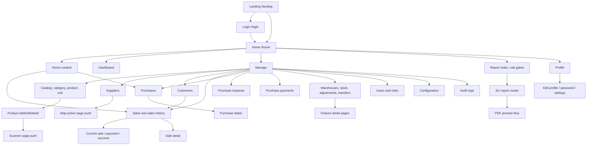

# Flutter Screen Inventory

Inventory based on `frontend/lib/`, `routes/app_pages.dart`, route constants, and navigation calls. Named-route screens are registered in GetX; pages pushed directly are marked as such. Forms rendered as dialogs/sheets are grouped with their feature. A widget's exact presentation style is marked unclear when source navigation does not establish it.

## Groups

| Group | File | Number of screens | Short description |
|---|---|---:|---|
| Auth (done) | [screen/SCREENS_AUTH.md](screen/SCREENS_AUTH.md) | 2 | Implementation complete: startup/sign-in, pre-sign-in preferences, recovery guidance, and browser autofill fixes. Manual device, screen-reader, and password-manager QA pending. |
| Home (done) | [screen/SCREENS_HOME.md](screen/SCREENS_HOME.md) | 6 | Done: all six screens redesigned—Home shell, Home content, Dashboard, Manage, Report index, and Profile. |
| Suppliers (done) | [screen/SCREENS_SUPPLIERS.md](screen/SCREENS_SUPPLIERS.md) | 5 | All five redesigned: responsive list/detail, shared forms, and accessible map picker. Manual device/browser QA pending. |
| Catalog (done) | [screen/SCREENS_CATALOG.md](screen/SCREENS_CATALOG.md) | 10 | Products list/detail/forms and categories list/forms redesigned 2026-11; units and product scanning remain. |
| Customers (done) | [screen/SCREENS_CUSTOMERS.md](screen/SCREENS_CUSTOMERS.md) | 4 | All four redesigned: responsive list, shared guarded forms, themed sale selector. Manual device/browser QA pending. |
| Sales | [screen/SCREENS_SALES.md](screen/SCREENS_SALES.md) | 6 | Sale creation, checkout, and sales history. |
| Purchases | [screen/SCREENS_PURCHASES.md](screen/SCREENS_PURCHASES.md) | 4 | Purchase list, details, and purchase forms. |
| Purchase Requests | [screen/SCREENS_PURCHASE_REQUESTS.md](screen/SCREENS_PURCHASE_REQUESTS.md) | 4 | Purchase request list and forms/details. |
| Purchase Payments | [screen/SCREENS_PURCHASE_PAYMENTS.md](screen/SCREENS_PURCHASE_PAYMENTS.md) | 4 | Purchase payment list, details, and forms. |
| Stock | [screen/SCREENS_STOCK.md](screen/SCREENS_STOCK.md) | 15 | Warehouses, warehouse stock, adjustments, and transfers. |
| People & Access | [screen/SCREENS_PEOPLE.md](screen/SCREENS_PEOPLE.md) | 7 | User and role management. |
| Configuration | [screen/SCREENS_CONFIGURATION.md](screen/SCREENS_CONFIGURATION.md) | 10 | Payment types, currencies, and system configuration. |
| Audit | [screen/SCREENS_AUDIT.md](screen/SCREENS_AUDIT.md) | 2 | Audit history and event detail. |
| Reports | [screen/SCREENS_REPORTS.md](screen/SCREENS_REPORTS.md) | 8 | Six report pages, PDF preview, and page-format dialog. |
| Profile | [screen/SCREENS_PROFILE.md](screen/SCREENS_PROFILE.md) | 2 | Account edit flows; the Profile tab is grouped under Home. |

## Redesign

Auth implementation is complete. Startup and sign-in include responsive layouts, safe feedback, pre-sign-in language/theme controls, administrator password-recovery guidance, and corrected web autofill hints with accessibility enabled. All 180 Flutter tests, two web-autofill tests, targeted analysis, the standard web build, and headless Chrome checks passed. Physical-device, spoken screen-reader, and real password-manager save/retrieval checks remain pending; see the Auth inventory for the exact checklist.

The complete Home group redesign is done: Home shell, Home content, Dashboard, Manage, Report index, and Profile. All six screens use consistent responsive layouts and theme-aware surfaces. The desktop sidebar persists across feature and detail routes, with the logo at the top and Profile at the bottom. Dashboard includes redesigned KPIs, charts, and product lists; Manage and Report have independent searchable directories; Profile includes redesigned account, personal-information, and preferences panels. All 172 Flutter tests, targeted analysis, and the standard web build passed. Manual live-browser, physical-device, and screen-reader checks remain pending.

The Suppliers group redesign is implemented across all five screens: list, Add, Edit, detail and location picker. It matches Home surfaces and desktop navigation, preserves search through refresh/writes, guards supplier submissions, retains failed drafts, and adds keyboard coordinate entry. English/Khmer and light/dark states are covered by focused tests, with contrast and tap-target checks. See the [Suppliers inventory](screen/SCREENS_SUPPLIERS.md) for results and remaining manual checks.

The Products workflow redesign is done (Catalog group remains incomplete: Categories, Units, and the scanner screen are not part of this pass). Scope: Products list (themed lazy cards below 760px of available width / table at or above, centered max-1240 content, distinct loading/empty/no-match/failure states with retry banner), Product detail (image stacked below 900px / beside at or above, wrapping information rows, SafeArea footer), and one shared Add/Edit form (grouped HomeSectionCard sections, inline validation with exact copy in English and Khmer, duplicate-submission guard, draft retention and safe error copy on failed writes, native image upload with web-unavailable message, existing scanner contract). Search query and category filter now compose; `clearFilters` no longer touches the query or form selections; routes, argument types, payload keys, confirmed deletion, and Sale refresh are unchanged. Verified results: 205 Flutter tests pass with 1 web-only test skipped (`flutter test --platform chrome` run was skipped by user instruction), targeted analysis reports 0 new diagnostics (baseline 72 → 62 issues), `flutter build web` exits 0, and changed Dart files are `dart format` clean except the two locale maps, which were already unformatted at baseline and were excluded from the format gate. Not performed: screenshots, live-browser upload check, physical-device camera/upload, live-API error checks, TalkBack/VoiceOver, and in-app four-route walk under DesktopAppShell (list/detail flows are covered by widget tests; forms were tested without the shell wrapper).

The Catalog category screens are redesigned: responsive card/table list with themed loading/error/empty/no-match states and retry, a guarded search that survives refresh/writes, and one shared Add/Edit form with inline validation, duplicate-submission guard, dismissal blocked while saving, and draft retention on failed writes. Verified: 281 Flutter tests pass with 1 web-only test skipped, `flutter analyze` shows no diagnostics in the changed files, `flutter build web` exits 0, and the changed Dart files are `dart format` clean. Catalog remains incomplete: Units list/add/edit and the product scanner. Manual device/browser, screen-reader, and live-API checks remain pending.

The Customers group redesign is implemented across all four screens: the responsive list (themed cards below 800px content width / table at or above with a large-text fallback, centered max-1240 content, distinct loading/error/empty/no-match states with retry and pull-to-refresh), one shared Add/Edit form (inline validation with exact English/Khmer copy, duplicate-submission guard, dismissal blocked while saving or uploading, draft retention on failed writes, shared photo preview cleared on form entry, native upload with the browser-unavailable message), and the sale customer selector (localized themed card plus a searchable picker with retry; `SaleController` untouched). The controller gained guarded loads/writes, a 60-second shared cache, and search that survives refresh/writes; the `/customer` route, argument types, and `{photo, name, phone, address, is_active}` payload are unchanged, and the external pravatar photo fallback was removed. Verified: 340 Flutter tests pass with 1 web-only test skipped, `flutter analyze` reports zero diagnostics in the changed files (53 pre-existing elsewhere), `flutter build web` exits 0, and the changed Dart files are `dart format` clean (the two locale maps were unformatted at baseline and excluded). Manual device/browser, screen-reader, live-API, and real Supabase upload checks remain pending; see the [Customers inventory](screen/SCREENS_CUSTOMERS.md).

## Screens

| Screen | File path | Group |
|---|---|---|
| Landing | `frontend/lib/screen/landing.dart` | Auth |
| Login | `frontend/lib/screen/auth/login_screen.dart` | Auth |
| Home shell | `frontend/lib/screen/home/home_screen.dart` | Home |
| Home content tab | `frontend/lib/screen/home/home_content.dart` | Home |
| Dashboard tab | `frontend/lib/screen/dashboard/dashboard_screen.dart` | Home |
| Manage tab | `frontend/lib/screen/manage/manage_screen.dart` | Home |
| Report index tab | `frontend/lib/screen/report/report_screen.dart` | Home |
| Profile tab | `frontend/lib/screen/profile/profile_screen.dart` | Home |
| Categories | `frontend/lib/screen/category/category_screen.dart` | Catalog |
| Add category form | `frontend/lib/screen/category/widget/add_category_widget.dart` | Catalog |
| Edit category form | `frontend/lib/screen/category/widget/edit_category_widget.dart` | Catalog |
| Products | `frontend/lib/screen/product/product_screen.dart` | Catalog |
| Add product | `frontend/lib/screen/product/widget/add_product_widget.dart` | Catalog |
| Edit product | `frontend/lib/screen/product/widget/edit_product_widget.dart` | Catalog |
| Product detail | `frontend/lib/screen/product/widget/product_card_detail_widget.dart` | Catalog |
| Product scanner | `frontend/lib/widget/test_product_scanner_page.dart` | Catalog |
| Units | `frontend/lib/screen/unit/unit_screen.dart` | Catalog |
| Add unit form | `frontend/lib/screen/unit/widget/add_unit_widget.dart` | Catalog |
| Edit unit form | `frontend/lib/screen/unit/widget/edit_unit_widget.dart` | Catalog |
| Suppliers | `frontend/lib/screen/supplier/supplier_screen.dart` | Suppliers |
| Add supplier form | `frontend/lib/screen/supplier/widgets/supplier_add_widget.dart` | Suppliers |
| Edit supplier form | `frontend/lib/screen/supplier/widgets/supplier_edit_widget.dart` | Suppliers |
| Supplier detail | `frontend/lib/screen/supplier/widgets/supplier_detail_card_widget.dart` | Suppliers |
| Supplier location picker | `frontend/lib/screen/supplier/location_picker_page.dart` | Suppliers |
| Customers | `frontend/lib/screen/customer/customer_screen.dart` | Customers |
| Add customer form | `frontend/lib/screen/customer/widget/add_customer_widget.dart` | Customers |
| Edit customer form | `frontend/lib/screen/customer/widget/edit_customer_widget.dart` | Customers |
| Sale customer selector | `frontend/lib/screen/sale/widget/select_customer_card_widget.dart` | Customers |
| Sale product selection | `frontend/lib/screen/sale/sale_screen/sale_screen.dart` | Sales |
| Current sale/cart | `frontend/lib/screen/sale/current_sale/current_sale_screen.dart` | Sales |
| Sale payment | `frontend/lib/screen/payment/payment_screen.dart` | Sales |
| Payment success/receipt | `frontend/lib/screen/sale/widget/payment_success_widget.dart` | Sales |
| Sales list | `frontend/lib/screen/sale/sale_list/sale_list_screen.dart` | Sales |
| Sale detail | `frontend/lib/screen/sale/sale_list/widget/sale_list_detail_widget.dart` | Sales |
| Purchases | `frontend/lib/screen/purchases/purchases_screen.dart` | Purchases |
| Add purchase form | `frontend/lib/screen/purchases/widget/add_purchase_widget.dart` | Purchases |
| Edit purchase form | `frontend/lib/screen/purchases/widget/edit_purchase_widget.dart` | Purchases |
| Purchase detail | `frontend/lib/screen/purchases/widget/purchase_detail_widget.dart` | Purchases |
| Purchase requests | `frontend/lib/screen/purchase_request/purchase_request_screen.dart` | Purchase Requests |
| Add purchase request | `frontend/lib/screen/purchase_request/widget/add_purchase_request_widget.dart` | Purchase Requests |
| Edit purchase request | `frontend/lib/screen/purchase_request/widget/edit_purchase_request_widget.dart` | Purchase Requests |
| Purchase request detail | `frontend/lib/screen/purchase_request/widget/card_purchase_request_detail_widget.dart` | Purchase Requests |
| Purchase payments | `frontend/lib/screen/purchase_payment/purchase_payment_screen.dart` | Purchase Payments |
| Add purchase payment | `frontend/lib/screen/purchase_payment/widget/add_purchase_payment_widget.dart` | Purchase Payments |
| Edit purchase payment | `frontend/lib/screen/purchase_payment/widget/edit_purchase_payment_widget.dart` | Purchase Payments |
| Purchase payment detail | `frontend/lib/screen/purchase_payment/widget/purchase_payment_detail_widget.dart` | Purchase Payments |
| Warehouses | `frontend/lib/screen/stock/warehouse/warehouse_screen.dart` | Stock |
| Add warehouse | `frontend/lib/screen/stock/warehouse/widget/add_warehouse_widget.dart` | Stock |
| Edit warehouse | `frontend/lib/screen/stock/warehouse/widget/edit_warehouse_widget.dart` | Stock |
| Warehouse detail | `frontend/lib/screen/stock/warehouse/widget/ware_house_detail_widget.dart` | Stock |
| Warehouse stock | `frontend/lib/screen/stock/warehouse_stock/warehouse_stock_screen.dart` | Stock |
| Add warehouse stock | `frontend/lib/screen/stock/warehouse_stock/widget/add_warehouse_stock_widget.dart` | Stock |
| Edit warehouse stock | `frontend/lib/screen/stock/warehouse_stock/widget/edit_warehouse_stock_widget.dart` | Stock |
| Stock adjustments | `frontend/lib/screen/stock/stock_adjustment/stock_adjustment_screen.dart` | Stock |
| Add stock adjustment | `frontend/lib/screen/stock/stock_adjustment/widget/add_stock_adjustment_widget.dart` | Stock |
| Edit stock adjustment | `frontend/lib/screen/stock/stock_adjustment/widget/edit_stock_adjustment_type_widget.dart` | Stock |
| Stock adjustment detail | `frontend/lib/screen/stock/stock_adjustment/widget/stock_adjustment_detail_widget.dart` | Stock |
| Stock transfers | `frontend/lib/screen/stock/stock_transfer/stock_transfer_screen.dart` | Stock |
| Add stock transfer | `frontend/lib/screen/stock/stock_transfer/widget/add_stock_transfer_widget.dart` | Stock |
| Edit stock transfer | `frontend/lib/screen/stock/stock_transfer/widget/edit_stock_transfer_widget.dart` | Stock |
| Stock transfer detail | `frontend/lib/screen/stock/stock_transfer/widget/stock_transfer_detail_card_widget.dart` | Stock |
| Users | `frontend/lib/screen/user/user_screen.dart` | People & Access |
| Add user | `frontend/lib/screen/user/widget/add_user_widget.dart` | People & Access |
| Edit user | `frontend/lib/screen/user/widget/edit_user_widget.dart` | People & Access |
| User detail | `frontend/lib/screen/user/widget/user_detail_card_widget.dart` | People & Access |
| Roles | `frontend/lib/screen/role/role_screen.dart` | People & Access |
| Add role | `frontend/lib/screen/role/widget/add_role_widget.dart` | People & Access |
| Edit role | `frontend/lib/screen/role/widget/edit_role_widget.dart` | People & Access |
| Payment types | `frontend/lib/screen/payment_type/payment_type_screen.dart` | Configuration |
| Add payment type | `frontend/lib/screen/payment_type/widget/add_payment_type_widget.dart` | Configuration |
| Edit payment type | `frontend/lib/screen/payment_type/widget/edit_payment_type_widget.dart` | Configuration |
| Currencies | `frontend/lib/screen/currency/currency_screen.dart` | Configuration |
| Add currency | `frontend/lib/screen/currency/widget/add_currency_widget.dart` | Configuration |
| Edit currency | `frontend/lib/screen/currency/widget/edit_currency_widget.dart` | Configuration |
| System configuration | `frontend/lib/screen/system_configuration/system_configuration_screen.dart` | Configuration |
| Add configuration | `frontend/lib/screen/system_configuration/widget/add_system_configuration_widget.dart` | Configuration |
| Edit configuration | `frontend/lib/screen/system_configuration/widget/edit_system_configuration_widget.dart` | Configuration |
| Configuration detail | `frontend/lib/screen/system_configuration/widget/card_system_cofiguration_detail_widget.dart` | Configuration |
| Audit logs | `frontend/lib/screen/audit_logs/audit_logs_screen.dart` | Audit |
| Audit log detail | `frontend/lib/screen/audit_logs/widget/audit_log_detail_widget.dart` | Audit |
| Sales report | `frontend/lib/screen/report/all_report/sales_report_screen.dart` | Reports |
| Sale payment report | `frontend/lib/screen/report/all_report/sale_payment_report_screen.dart` | Reports |
| Purchase report | `frontend/lib/screen/report/all_report/purchase_report_screen.dart` | Reports |
| Purchase payment report | `frontend/lib/screen/report/all_report/purchase_payment_report_screen.dart` | Reports |
| Stock ledger report | `frontend/lib/screen/report/all_report/stock_ledger_report.dart` | Reports |
| Profit and loss report | `frontend/lib/screen/report/all_report/profit_and_loss_report.dart` | Reports |
| PDF preview | `frontend/lib/screen/report/pdf_preview_screen.dart` | Reports |
| Edit profile | `frontend/lib/screen/profile/widget/edit_profile_widget.dart` | Profile |
| Change password | `frontend/lib/screen/profile/widget/change_password_widget.dart` | Profile |

## Navigation map

## Orphaned or uncertain screens

- `frontend/lib/screen/report/pdf_preview_screen.dart`: no GetX route registration found; a PDF preview flow is opened from the sales report, but whether it instantiates this widget is unclear.
- `/warehouse-detail` and `/user-detail` are registered. Their intended callers were not clearly found in the navigation-call scan.
- `frontend/lib/screen/purchase_request/widget/card_purchase_request_detail_widget.dart` is a full Scaffold page but is not registered in `AppPages`; whether another direct call reaches it is unclear.
- Forms listed in group files are feature widgets, not all independently routed. Their exact hosting as dialog, bottom sheet, or inline content is unclear where no caller was found.
